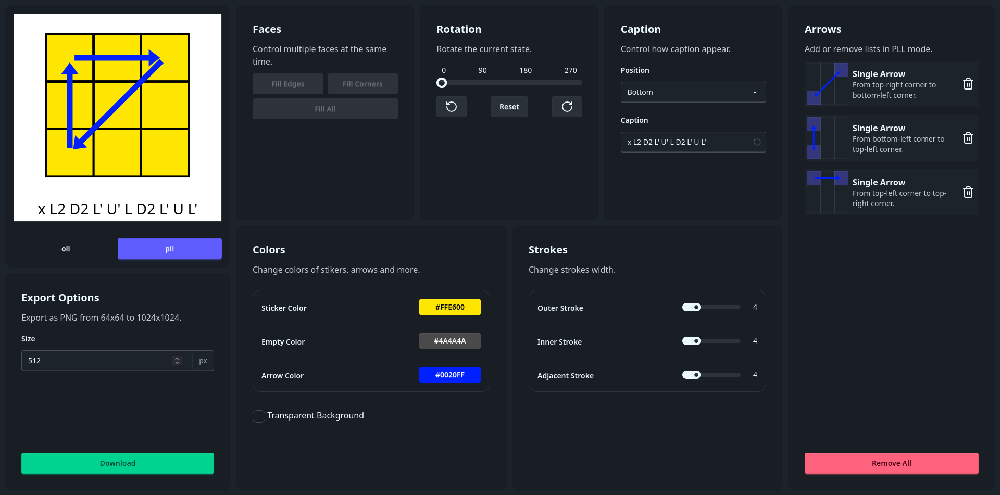
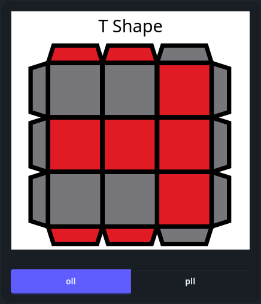
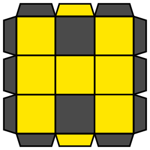

# Rubiks-Gem
Generate images of OLLs and PLLs cases.

**Demo:** https://rubiks.luiz734.qzz.io/

## Screenshots


Change the looking as you like:



Remove background, captions and export:




## Build using Docker (better)
```bash
docker compose run --rm build
```
Or with podman:
```bash
podman compose run --rm build
```

# Build manually
```bash
npm run build
```
After that check the `dist` directory.
